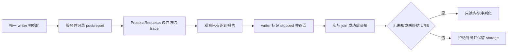

# A23 trace owner、退出与导出准备（2026-10-13）

后续已完成[实际handler隔离候选](A23_EP0_HANDLER_CANDIDATE.md)：hooks、停止/交接API、
完整ELF和账本封装已在隔离副本验证，下文描述本策略阶段；文件sink和实机验证仍未完成。

本轮完成独立 owner 策略、原始 report 适配和 libnx ELF 链接验证。28 个原生注入场景通过
ASan/UBSan，254 项相关 Python 回归无跳过。当前 A23 生产源码、协议、timeout、部署及三份
凭据保持不变；USB/SD 访问为 0，remaining=0，根因未确认。

这还不是完整插桩固件。实际 handler 的 owner hooks、停止入口、文件 sink 和候选构建身份
绑定尚未接入；本轮 ELF 只验证适配器 ABI/链接，不能部署或当作已验证的采集工具。

## 当前源码给出的边界

- [main.c](../../../source/sysmodule/main.c) 的 VideoStreamThread 是 EP0 唯一 owner，先等待
  USB ready，再在每轮调用 UvcDeviceProcessRequests。非 streaming 时随后 sleep 50ms。
  应在该线程开始服务请求前初始化静态 trace/账本，在 ProcessRequests 返回后才检查冻结。
- 正常 main 尾部顺序为：退出 g_running 循环 → g_running=false → join 视频 → join 音频 →
  UvcDeviceExit。仅有两处 false 写入（main:262、__appExit:211），均在退出路径；当前没有
  正常运行中的 stop 触发入口。因此不能承诺“挂到退出就能取到记录”，也不能用主机超时
  自动结束设备会话。__appExit 在 main 返回后关闭设备及 Core/SD。
- [core.c](../../../source/core.c):208 的 JoinThread 丢弃 threadWaitForExit 的 Result，随后
  threadClose。候选接入必须保留实际等待结果；调用过这个 void helper 不能满足本轮 handoff
  的成功条件。此发现不是已经观测到线程退出失败。
- [uvc_device.c](../../../source/uvc/uvc_device.c):1328、1351 的控制 helper 在 post、wait、
  GetReportData 失败时直接返回；局部原始 report 在 parse 后不保留。等待超时、StallCtrl、
  eventClear 或设备断开都没有给出匹配 URB 的终结报告。
- 同文件 _pollIsoProbe 只对自己的 ID 且 status 3/4/5 标终结；1/2 保留。CANCEL 的 cancel
  调用和 500ms wait 本身不解除占用，后续仍需 report。UvcDeviceExit 的 interface close/
  usbDsExit 不是本轮已核验的排空证据；并未证明 close 不会排空，相关 HOS 语义仍未审查。

## 原始 status 与 parse Result 必须分别保留

审查了本机 `/opt/devkitpro/libnx/lib/libnx.a` 中 usbds.o 的实际
usbDsParseReportData 机器码，而非只查看头文件。函数长 0xa0 bytes，8 处指令 anchor 与库、
对象、函数字节的 SHA256 一起保存。匹配 ID 后读取 entry+12 的 urb_status，映射如下：

| 原始状态 | helper Result | 本轮所有权策略 |
| --- | --- | --- |
| 3 | 0 | 匹配通道/ID 时按 A23 终结假设解除占用 |
| 4 | 0x828c | 同样为终结，但传输失败 |
| 5 | 0x748c | 同样为终结，但传输失败 |
| 其他 | 0x108c | 保持占用，不能据此排空 |
| 未找到 ID/无 report | 0x1359 | 保持占用 |

因此 parse 非零不等于仍占用，parse 结果也不能代替完整原始报告。3/4/5 的 DMA 终结语义
在本轮仍是冻结 A23 的静态假设，没有新增实机验证。终结失败与传输成功也不等价。

## 可执行的独立策略

[ep0_trace_owner.h](../device/ep0_trace_owner.h) 使用静态 storage、一个 writer 和一次交接，
没有 allocation、锁、USB 或文件操作。身份和 join Result 均由调用方提供；数值相等检查
不认证实际线程，也不解决并发访问。测试没有运行多线程竞争。生产接入必须遵守唯一 writer
及真实线程等待的前提。

账本有 16 个永久身份槽，通道为 interface×2+IN(0)/OUT(1)，ISO=8。所有 post/report
都需观察，包括 trace 已满或冻结后的操作；不能从可能丢失的 trace 前缀重建排空证明。
ID=0 可以有效，必须另外传入 id_valid；不同通道同 ID 互不解除。

同一会话不重复使用 (channel,id)，已终结 ID 仍占槽，防止迟到旧报告错误解除新 buffer。
第 17 次 post、重复 ID、无有效 ID 或失败 post 都永久锁住导出。失败 post 的 IPC 所有权
结局未在本轮证明，因此采取保守未知状态；不声称该失败实际接受了 buffer。
16 槽是否覆盖真实枚举及目标窗口尚未验证，满后只拒绝导出，不改变原 USB 调用或重试。

GetReportData 失败保持原占用；成功 batch 先整体核对 count≤8、有效指针、无重复 ID，
随后只解除已接受且同通道/ID 的 3/4/5。1/2/未知 status 保持占用，未匹配项计数。诊断
写在 report_count 以外的 slot 不参与终结判断。损坏 batch 永久锁住导出，避免半批次解除。

生命周期如下；迟到 report 可在冻结后、writer 结束前更新账本，不修改 trace：

processing 内不能 freeze/stop。freeze 本身不是排空或线程退出。handoff 要求 stopped、
冻结、非 writer 的 exporter 及成功 join；导出还要求 fault=0、pending=0。拒绝时不触碰
输出 buffer，短输出同样拒绝；交接后旧 writer 的修改 API 拒绝，重复序列化完全相同。
导出不要求 trace 无丢失：已排空的溢出/STOPPED trace 可以保存，但解码不能宣称完整观察。

此处 export **只写调用方内存**。没有 SD sink、自动停止、USB close 或补发控制命令；
也没有证明停止时主机已经结束交互。完整会话结束条件及文件落盘顺序仍需候选单独实现。
未知 URB 时不调用取消/close 来凑导出条件，不清空账本或重启取证。

## 构建及验证范围

[ep0_trace_libnx.h](../device/ep0_trace_libnx.h) 按真实 UsbDsReportData ABI 转换已有报告，
不新增 IPC。GetReportData 失败时不读输出，count>8 在读取 entry 前拒绝。适配器尚未插入
实际 EP0/ISO helper，所有 post 都被观察这一前提仍未由真实接入保证。

[audit_a23_trace_owner.py](../tools/audit_a23_trace_owner.py) 核对冻结 A23 三个源码哈希、
owner/退出/JoinThread anchor 与三份凭据，保存源码副本后运行
[原生场景](../tests/ep0_trace_owner_test.c)。覆盖无 join/失败 join、错误 writer、handler
内 freeze、timeout/cancel/disconnect、wrong ID/channel、1/2/未知状态、坏报告/失败 post、
身份重用/容量、0 ID、3/4/5、冻结后迟到终结及 trace 溢出。28 项通过 ASan/UBSan。
所有输出 trace 固定 simulation/STOPPED，测试 ID 是常量，不是真实 boot/session。

[链接 fixture](../tests/ep0_trace_owner_link.c) 使用真实 libnx 头文件、libnx.a、switch.specs，
编译并完整链接独立 ELF。ELF64/AArch64/DYN 与 checked_adapter 符号核验通过，记录 ELF hash、
编译器版本和库/ABI hash。未构建生产对象、NSO、NSP，未运行 ELF；这不证明 HOS 中可运行、
设备线程交接、SD 可写或插桩耗时。原同步 LOG 和所有 timeout 保持原样。

源码/账本测试见 [test_ep0_trace_owner.py](../tests/test_ep0_trace_owner.py)，8 项新检查。
BOOL 修正后的 fixture 环境下，相关回归共 254 项无跳过；并非全库 discovery。

封存证据：[owner review](../private/analysis/A23-EP0-trace-owner-review-20261013/audit.json)；
源码快照、回归、凭据及旧 manifest 复核另存
[owner validation](../private/analysis/A23-EP0-trace-owner-validation-20261013/validation.json)。
旧 [trace review](../private/analysis/A23-EP0-memory-trace-review-20261013/audit.json) 保持原样。

下一步只在电脑生成隔离的实际 handler 候选副本，把 post/原始 reports 与 owner 账本接上，
在同一服务模型中对照未插入源码；补明确停止边界和落盘方案，再做完整候选 libnx 链接及
构建 hash 绑定。真实 writer/join、ID 是否重用、3/4/5 所有权和记录/SD 开销仍待观察。
remaining0，不创建新次数，不部署或测试来填补这些空缺。
