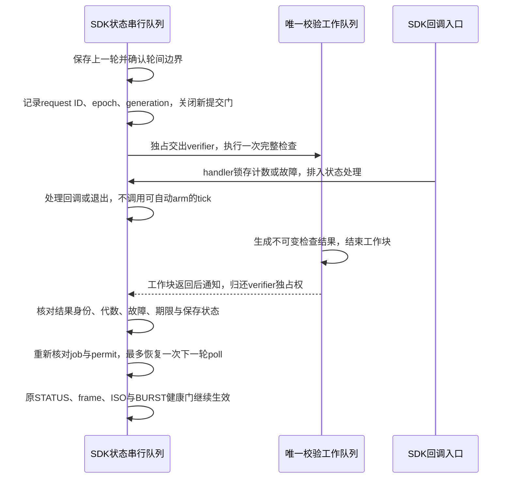

# 完整校验与回调的最小队列设计（2026-10-25）

本轮把[剩余校验研究](A23_LIVE120_RESIDUAL_GUARD.md)推进到具体时序、接线与停止条件，并完成一个文件校验期间的原生dispatch探针。结论是值得继续一个仅针对两次轮间边界的离线候选：保留每轮完整检查，将它从回调串行队列移开，校验期间禁止自动arm。它改善回调被串行处理的机会，仍不能消除逐轮完整检查造成的空档，也不是持续流方案。

现有644来源、已消费369记录、八个namespace及旧封存保持。本轮只编译一个临时探针、运行8个本地进程，无IOKit/IOUSBHost链接、USB/SD访问、真实SDK对象、正式许可或新范围。旧120件build只在临时根重放，不作为当前126件freshness验证。

## 冻结源码中的四个接线点

| 代码 | 已核对行为 | 设计要求 |
| --- | --- | --- |
| generated/live_scope.m | 非inflight tick先verifyScope再entry tick；verifier保存_scope/_witness/_failed/_coreTimings；permit.result再次调用verifier的job检查 | verifier不能同时由工作队列与串行队列访问；不能仅后台调用verifyCore后继续原tick |
| generated/live_entry.m、live_driver.m | 已启动entry tick调用driver poll；poll空闲时可arm下一轮；saved后递增epoch，下一次poll继续 | 增加明确的轮间等待边界，校验中不调用会自动arm的entry tick/driver poll |
| generated/live_adapter.m、live_driver.m | interest及ISO/control入口锁存原子故障/计数，再转串行状态；SDK interface绑定同一queue | 原子锁存只证明handler已执行，不证明内核/总线事件已被独立处理；保留最后SDK健康检查 |
| generated/live_owner.m、live_adapter.m | acknowledgeEvidenceSaved释放owner自己的data/transaction引用；lease仍保存六块store，runtime touched后closeUnused拒绝清理并自持有 | saved、owner完成、250ms、主机进程wait都不授权存储复用或认定SDK排空 |

此外，STATUS同步读、journal append、saveDirectory的写入/fsync/回读仍在串行路径。仅搬完整校验不能保证回调处理硬延迟，不能宣称整个主队列已无阻塞。所有实际源码行号和摘要见本轮source-anchors.json。

## 第一版候选限定为两次轮间交接

只处理epoch0 saved→epoch1 arm、epoch1 saved→epoch2 arm。保持固定三组/128项/lead32/48序号、每轮STATUS/BURST/STATUS、原期限、任何interest停止、完整哈希/manifest/额外节点检查和原失败留证。WAITING、首次启动、末轮250ms观察及最终导出先保留原合同；这意味着末轮观察阻塞与长期持续流仍不在这个候选的验证范围内。

不复用缓冲区、不新增第四轮，不把一次检查结果供多个epoch使用。候选接线尚未实现，没有当前126件build或硬件入口。

主队列不dispatch_sync等待worker，也不为每个1ms tick创建校验：只允许一个未完成请求。worker不读取driver/owner/lease/permit，不调用任何USB或SDK接口；只访问自己独占的verifier和冻结根。串行队列在此期间不读取verifier的scope/result/cadenceMetrics，也不让permit的verifier回调访问它。已有回调处理和requestExit可继续，但最终失败/验收导出必须等verifier返回或使用明确标为上次已完成的不可变证据，不能伪装为本次结果。

**收到结果值不等于工作块已返回。** 实际接线应以dispatch group完成通知或等价的明确返回协议交回独占权，之后才在串行队列执行verifyLiveJob和permit.result。不能只在worker末尾dispatch_async一个reply就认定所有清理已结束；这也不是SDK回调排空协议。

| 状态 | 可执行 | 不能据此执行 |
| --- | --- | --- |
| BoundarySaved | 确认上一轮已保存、无当前pending；取得下一epoch和请求身份 | 复用上一组存储 |
| Checking | 一个worker完整检查；串行处理回调/退出/故障 | 自动arm、另一轮检查、共享读取可变verifier |
| Returned | worker已返回、独占权归还；检验不可变结果 | 用错误request/phase/epoch或旧generation恢复tick |
| ReadyOnce | job/permit重新核对通过；单次消费就绪标记 | 把就绪标记当新物理授权、供多个epoch使用 |
| Issuing | 进入原下一轮arm；STATUS/frame/SDK预算逐项守门 | 把上次frame sample提前跨校验复用 |
| StoppedRetained | 锁存失败、禁后续arm、保持资源和worker归属 | 自动重试、取消worker后假定已返回、清理未决SDK存储 |

结果至少绑定job/scope摘要、request ID、目标epoch、请求时generation/故障代数、检查序号/phase、开始/结束tick和完整检查判定；任何身份不匹配、重复或过期结果都丢弃，不产生新检查或新提交。失败状态只能加重，成功回执不能清除后来发生的故障。若另加检查期限，只能到期后锁存停止并保留worker；同步文件调用不保证可取消或硬实时返回。

generation用于失效本地结果，不代表物理设备session身份或文件系统变化监控。工作结束后文件仍可能变化，job重查也不能使整个目录成为原子快照；延迟接收回执增加的检查后间隔必须记录，不隐藏为freshness已获证明。

## 原生探针实际证明了什么

使用同一冻结120件guard核心，真实读取临时11根。仅在第1024次readFile入口插入固定hook：排入本地通知；worker版等待通知已在串行队列处理后继续完整校验，串行对照只排入、不中途等待。这个握手刻意固定交错，结果用于证明所选交错可发生，不用于比较性能或预测真实SDK通知延迟。

| 场景 | 完整文件检查 | 通知在检查期间处理 | 本地最后门 |
| --- | --- | --- | --- |
| normal | 通过 | 是 | 接受一次 |
| serial-control | 通过 | 否，检查后才处理 | 接受一次 |
| fault-during-check | 通过 | 是 | 拒绝 |
| stop-during-check | 通过 | 是 | 拒绝 |
| stale-generation | 通过 | 是 | 拒绝 |
| tampered-file | 拒绝 | 是 | 拒绝 |
| duplicate-receipt | 通过 | 是 | 两回执只产生一次就绪 |
| fault-before-final-gate | 通过 | 是 | 已就绪后发生故障仍拒绝 |

1次编译、1次链接检查、8个探针进程均由创建者直接wait；7次文件接受、1次文件变化拒绝。每进程只有一次实际完整文件检查，没有SDK submit或正式许可检查。探针中verifier只留在worker，返回不可变值，**没有认证真实verifier独占权交回、生产entry/permit接线、SDK存储/回调或真实退出清理**。进程直接wait也不能替代上述证明。

## 故障在提交边界如何解释

校验期间、回执排队期间或ReadyOnce之后且最后门之前已观察到的interest/坏回调/退出，都必须拒绝后续arm。原子故障必须在最后门和原SDK guard重新读取，不能仅信任成功回执里的故障值。

仍有明确未闭合窗口：最后读取原子标志后、实际SDK调用前，另一个handler可能才锁存故障。generation/原子load/主队列串行本身不能把外部SDK调用变成不可分事务。本轮探针没有制造SDK调用，也没有覆盖该窗口。

候选只能把最后门作为本地“准备发起”的线性化点：若故障在此后才观察到，必须按可能已有ISO的失败处理，保持原单次abort边界与资源持有；在能阻止BURST时继续阻止，不能追认“绝无故障后提交”或安全释放。若目标要求内核/总线故障发生之后绝无任何新提交，需要独立SDK/内核合同支持，当前本地证据不足。

## 吞吐与下一项

每轮3072字节；现有串行方案的周期仍包含完整检查、STATUS/保存和ISO窗口。把检查移到worker不会自动与上一轮inflight重叠，本候选仍从saved边界之后开始检查。不能拿上一轮检查去授权下一轮，也不提前取frame sample跨越这段耗时。

真实两次触发间隔317.456/385.854 ms对应每间隔3072字节约9.677/7.962 kB/s；这只是两个有限诊断间隔的载荷比，非持续吞吐测量或硬件总线能力。只用实测guard258.663/325.169 ms作分母也只能得到该成本假设下约11.876/9.447 kB/s的乐观算术上界，其他成本尚未计入；不是未来负载下的绝对上限。

下一项值得做的是**离线实现轮间worker返回后再恢复一次poll的最小接线**，保留同一个verifier的独占交接和现有permit复核，先验证错误phase/request、worker返回顺序、回执后故障及检查期间退出；避免复制整套通用监督器。当前设计与探针并未生成正式接收器，不申请硬件。持续流还需另立生产/排队/背压、容量与结束合同，当前三组缓冲区不设计为环形复用。

证据private/analysis/A23-guard-queue-design-20261025-r1，SHA256SUMS摘要7e7c726a517421cd597946cc3b28124b622aa76334a9bac96377b992a2a5b2a7。最终交接private/analysis/A23-guard-queue-design-closeout-20261025。644来源与八namespace保持；126件回收仍已弹出、日志pending=false、remaining0，当前设备现场状态未刷新。
