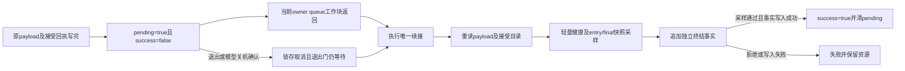

# 导出后的单次队列续接与终结证据（2026-10-26）

已离线修补[末端边界审查](A23_POSTEXPORT_BOUNDARY.md)中的四种确定性反例：最后比较或接受回执之后进入的interest、旧ISO回调，以及排在导出工作块后面的provider入口，现在会在新的终结采样中拒绝，不再使loop成功。最终r2的11个原生场景、23项消费者拒绝检查通过，正常模拟三轮仍由原SDK/entry/export和服务窗口消费者验收9216正确字节。

这是对原软件切点的有限修补。新成功含义是“单次owner queue续接后的显式采样与已保存快照一致，且终结事实写入成功”，不是“之后始终健康”。最后采样之后的事件、事实写入期间的竞态、真实SDK交付和排空仍未证明。

新增tools/build_a23_live132_completion.py、tools/audit_a23_live132_completion.py、tools/a23_live132_completion_consumer.py，共3来源；研究/候选来源总666，旧663字节保持。新build单独绑定132件基线及49..464完整消费历史；旧662接收器和原反例均保留，未重判真实417..464实测。

## 新的终结顺序

实际生成的A23CheckedTwoEpochRun必须在begin前配置owner queue。接受回执之后不再直接设置success/finished，而是冻结原payload、接受文件、entry/final快照及摘要，进入pending并dispatch_async一次。pending时tick不重新poll或导出，也不重新排队。新退出门要求原worker/terminal门通过且completion_pending=false。

续接先核对原payload与接受目录的精确文件/摘要，再调用coordinator.completionHealth。后者执行实际entry→driver轻量健康检查与permit状态读取，不增加完整来源校验。随后读取entry.result和finalStatus，与原接受时的冻结快照比较；已取消、operator-ack、entry停止/不完整或快照变化均不能接受。

新终结事实保存于live-completion/completion.json，按既有SHA256SUMS/COMMITTED规则封存，绑定candidate、entry、payload清单、接受清单、接受回执、entry/final快照摘要，以及RAW时钟中的请求、续接进入、采样起止时间。它明确标记historical_cut_only=true、queue_prefix_only=true，排空、复用、历史认证和未来事件排除均false。

旧payload与接受回执保持不可变。如果采样拒绝，追加accepted=false的事实，并停止会话，保留资源；不会覆盖旧validated=true回执来制造一致。若输入回执本已损坏，可能在排队前拒绝而无终结事实；若终结目录碰撞/写入失败，也不补次或授予成功。新消费者要求有效终结事实，因此这些材料不能被误接受。

## pending与关机确认

requestExit在pending时锁存取消并停止entry，即便operator-ack已令loop finished，也不会取消或绕过尚未执行的续接。模型检查明确观察到finished=true、pending=true时退出门为false。续接仍执行一次，写拒绝事实，保留exit_requests=1和operator_off_acknowledged=true，再释放该退出门。

这里“释放退出门”只允许控制进程按既有模型退出合同结束；不释放或复用SDK存储，不证明任何SDK work已经排空。真实硬件入口仍关闭。

## 消费者

新消费者首先要求有效的live-completion封存，并独立验证：

- 终结事实的精确字段、真正boolean与整数类型、一次续接/交回计数、无退出或operator-ack，以及有序的同域RAW时刻。
- fact绑定的candidate、payload、接受回执和entry/final摘要与磁盘文件一致；采样到的entry/final摘要与原冻结快照一致。
- accepted、disk_equal、sampled_healthy、snapshots_equal及当前完整性字段为true，stopped及不支持的强保证为false。

之后仍完整执行原SDK、entry、checked export、服务窗口、来源/worker时序及interest清单校验。旧消费者源码保持，只有在隔离模块内更换builder绑定；没有删减或放宽旧规则。输出明确current_state_after_sample_verified=false、overall_hardware_success=false。

旧的自洽历史接受材料若没有终结事实，也不能满足新合同。该消费者仍不能认证生产者或证明历史真实发生；完全伪造一套自洽数据不是本地哈希可以排除的事。

## 最终r2检查

| 原生场景 | 结果 |
| --- | --- |
| normal | 一次续接，终结采样/事实通过；原三轮9216正确字节及全部旧验收通过 |
| precheck-direct / payload-direct | 原提前检测仍拒绝，尚未进入终结排队 |
| postcheck-direct / receipt-direct | 先前错误成功的两个直接interest反例，现在终结事实accepted=false，loop失败 |
| payload-queued | 已排队的整个provider入口先于续接执行；即便pin仍在后面，原子锁存已能使采样拒绝 |
| postcheck-oldiso | 旧ISO入口标志在终结采样中发现，写拒绝事实，不授予成功 |
| postcheck-source | 历史来源快照仍可验收；新轻量健康采样不认证最后完整检查后的文件新鲜度，此限制保持显式 |
| pending-exit | pending时退出及模型关机确认不能越过退出门；续接一次后写拒绝事实 |
| completion-collision | 终结目录已存在，写入失败，不重试、loop失败，新消费者拒绝 |
| receipt-tamper | 接受回执被改写，输入冻结校验即拒绝，未排队续接 |

正常服务窗口152点、250.289ms、最大间隔1.857ms；最后的新增终结采样约4.288ms。这些是本次离线模型安排，不用于声称真实SDK/USB性能、持续服务或调度保证。五次完整收尾校验仍在服务窗口之后，没有被搬走或算作合格服务。

23项拒绝包括9种原生失败材料、11种终结事实类型/计数/摘要/时钟/取消/强保证篡改、缺失终结目录、旧历史接受副本以及模拟材料升级实测。正常与来源新鲜度边界两个对照均通过，后者不增加现场新鲜度保证。

两版共4个编译作业、22个原生fixture、8个文件模式进程，均创建者直接wait；22个模拟namespace仅在临时目录。r1全部11个原生进程exit0，但审计脚本错误要求receipt-tamper也必须续接一次，因实际在输入校验处更早拒绝而失败。r2只修正这一断言并重新绑定/验证；接收器修补和消费者逻辑与r1相同，失败版本原样保留。

## 剩余边界

一次队列续接覆盖的是该owner queue在该位置之前已排队、能执行到provider入口的工作前缀。通知可能尚未交付或属于其他队列，新的事件也可能在最后采样之后发生。最后采样和事实写入之间仍有间隔；事实写入成功不表示这段间隔中的所有未来故障都已被再次读取。

因此新合同只认证提供材料在明确采样切点的内部一致性。不能把loop success、completion accepted或终态文件当作持续健康、未来无事件、SDK drain或存储复用权限。最后一次完整来源检查之后的文件新鲜度同样未证明；本轮保留了这个正向边界对照，而未用反复全量检查掩盖它。

## 封存及下一项

| 材料（相对private/analysis） | SHA256SUMS摘要 |
| --- | --- |
| A23-live132-completion-review-20261026-r1 | e776b1bab3e5e9a84a61766f7363ffbf69c62eeeb24adf9247b5a9b018abc6a1 |
| A23-live132-completion-review-20261026-r2 | 550dfe97fdea47d478e4fb4fb99f1f0bbe114e0f22b777602956b371ffd9323d |

最终来源、票据、未改actual417、九namespace清单及交接见private/analysis/A23-live132-completion-closeout-20261026。二进制仅支持describe/check-archive/check-build；acquire-once仍exit2、workflow关闭、正式permit/issuer不可用。465..512仍只是未保留/未授权的软件模型范围；本轮USB/SD访问、真实SDK对象、新正式范围/namespace/授权均0，remaining=0、acquisition_enabled=false，日志不待回收，SD最后已弹出，现场未刷新。

下一项只离线核对“最终采样之后的故障”在终结事实、loop状态、调用者展示与归档消费者中的表述，明确历史采样结果与现场状态的区别；不扩大通用模型、不重开观察或重复相同实测、不准备硬件。任何关于排空、持续流或真实交付的新实验都需另立具体问题及停止条件。
