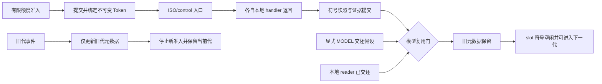

# Q2b 有限 slot/generation 离线模型（2026-10-26）

后续[Q2c整轮证据预算与交接合同](A23_Q2C_EVIDENCE_BUDGET_CONTRACT.md)已完成部署来源、边界和容量核对；下一项仅电脑设计整轮额度租约/停止门。下文为本模型阶段及当时下一步，原封存保持。

最小符号状态机已实现，最终 r2 的 34 项测试及 5760 种有限事件安排通过。旧代回调不会因指针相同而操作新代记录；未知交还、保存失败、未交还本地访问者、满池或元数据耗尽时，保留当前记录并停止新准入。

这不是接收器或 SDK 复用实现。原生交还只通过显式模型假设注入，未分配实际 backing、执行 SDK/USB/SD 操作或增加硬件权限。[Q2a 资料能力表](A23_Q2A_SDK_HANDOFF_CAPABILITIES.md)中的未知项保持，Q1 原件不变。

## 来源边界

新增三个独立研究来源：

- `tools/a23_q2_generation_model.py`：只有 dataclasses 依赖的纯符号状态机。
- `tests/test_a23_q2_generation_model.py`：反例及独立事件顺序 oracle。
- `tools/audit_a23_q2_generation_model.py`：绑定父交接、冻结来源与实际记录，运行检查并封存。

研究清单增至 675；原 Q1 receiver 的 672 来源束及 build 未改动，没有重编译或接线。675 不能回填为 Q1 的实测版本。

## 状态与复用门

每次准入创建不可变 Token(session,slot,generation,request)。slot 使用固定的符号地址和版本；同 slot 下一代故意使用同一个符号地址，以验证指针别名不能替代请求身份。它不是进程内真实指针，control 的符号地址也不对应 SDK control 回调的实际参数。

复用门同时要求：当前 Token 精确相同、已提交、ISO/control 各唯一入口且 handler 已完成、没有排队工作或本地 reader、快照与证据绑定同一代和版本、显式模型交还条件成立、无 poison/stop。

`AssumedHandoff` 必须使用固定 `Q2b-MODEL-ASSUMPTION-ONLY` 标记并绑定本次 Token。True、字典、“SDK_VERIFIED”标签、旧代交还对象或重放均不能授予条件。它仍只是假设，不是来自 SDK 的证据；符号提交成功也没有验证真实文件持久化。

旧代 callback、handler 或交还事件只触及所属旧记录的饱和计数，并停止新准入；不能清新代 queued/pending、产生新快照或使新代通过复用门。同代重复、错误状态或符号地址不匹配会 poison 并保留。

## 有界性

| 资源 | 模型政策 |
| --- | --- |
| slot | 配置 1..8 个，活跃 slot 不被覆盖；满池停新准入 |
| generation | 单 slot 单调递增；Token 不可变；没有回绕政策或 wire sequence 模型 |
| 请求/旧代元数据 | lifetime 上限 1..32，retired 元数据不删除、不自动 GC；耗尽就停 |
| 证据 credit | 0..32 个符号单位，准入前消费；回收 slot 不退还历史证据额度 |
| 本地 reader | 每请求最多 2 个；未交还不能复用 |
| 迟到/无效计数 | 饱和到 255，停止位保持；不无限增加历史日志或元数据 |

元数据上限意味着该模型最终停止；它没有通过删除旧回调身份来制造无限流。证据 credit 只是抽象容量，不等于设备 trace 条数或 Q2c 完整请求预算。

## 检查结果

| 检查 | 最终结果 |
| --- | --- |
| 测试方法 | 34 项通过，无 skipped/expected failure |
| 显式假设交还 | 7 个事件的 5040 种排列；仅 42 种满足独立依赖 DAG，并通过条件模型复用门 |
| 交还未知 | 6 个事件的 720 种排列；复用数 0，记录保持占用 |
| 顺序 oracle | 只根据事件位置与依赖边计算预期，不调用 Pool 的内部 gate |
| 旧事件 | ISO/control callback、queued handler、旧交还事件均不改新代记录 |
| 交还输入改标签 | 新 Token 参数搭配旧 AssumedHandoff 对象拒绝，新代保持占用 |
| 指针别名反例 | 同符号地址4096，旧 generation1/request1 与新 generation2/request2 不同；仅按指针比较会误接受，模型拒绝且新 pending 保持 |
| 证据 | 旧代回执、错误版本、保存失败及失败后补存均不能复用 |
| 其他停止 | reader 未返回、interest、手动 stop、未提交、满池、元数据与 credit 耗尽均保留 |

5040 个排列中，oracle 约束 ISO→handle_iso、control→handle_control、两个 handler→snapshot、snapshot→commit；交还假设可在这些局部事件之前或之后出现，但不替代任何一个本地条件。42 个结果是模型条件下的符号迁移，不是 42 次原生复用。

完整顺序与终态参与摘要计算，最终结果摘要：

- 显式模型交还：`8e63b8fd321c072e205d56c8497a268818cb74a54f31e226e2f9c8677d7e0624`。
- 未知交还：`dc76f991b15b4c7c3526953e4e5dddf0130ef955ecee3b036473d4210430ce62`。

首版 r1 的 33 项检查已通过；审查后补充“新参数 Token 搭配旧交还输入”的反例，r2 的 34 项通过。两版共两个 Python 模型审计进程，重复枚举不增加独立场景种类；没有原生 fixture 或编译。

## 证明范围与下一步

这里只检查公开模型事件驱动下的有限顺序，未验证真实并发交错、原生 DMA、文件持久化、callback source 关闭、metadata GC、wire sequence 回绕或 SDK ABI。Python 私有属性不是针对恶意代码的安全边界。没有把“模型不会读旧符号指针”推成“SDK 不会向旧地址写入”。

所有状态保留 native_handoff_proven=false、all_callback_drain_proven=false、physical_buffer_reuse_enabled=false、hardware_entry_enabled=false。缺少真实交还依据时，不能把 `AssumedHandoff` 接入真实接收器。

下一项优先仅离线 Q2c：按部署来源和完整请求安排核对 trace/身份/30s 窗口的预留、停止及无损证据交接。当前三轮216条、同形四轮282条/容量256仍不变；17条单请求预留不是每轮66条的最坏保证。先明确这些边界，不继续堆相同成功排列、不直接第四轮或实现自动 GC/真实复用。

## 封存

| 材料 | SHA256SUMS 摘要 |
| --- | --- |
| r1：33项与原源码 | `76de52e286ac7b415f2218c551046101a847e45cf18e5dba2458de3ef1e4924d` |
| 最终 r2：34项与675来源 | `af1ab927c0fecac9dcda2dc88f71d1d63fea45dfc18e09f4f38159f1c0fcbd36` |

最终审计为 `private/analysis/A23-q2b-generation-model-review-20261026-r2`；交接为 `private/analysis/A23-q2b-generation-model-closeout-20261026`。源码、tests.log、条件/未知排列摘要、指针别名反例、旧记录及十个 namespace 摘要均留证。

Q1 actual465/namespace465、旧 actual417/九 namespace、138 件快照与全部 sealed evidence 保持。remaining=0、acquisition_enabled=false、日志 pending=false，SD 最后已弹出，现场不推定。本轮没有新增硬件范围、授权、SDK、USB 或 SD 操作。
