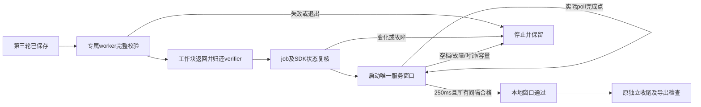

# 末轮观察的队列服务证据候选（2026-10-25）

继续离线审查[417..464实测](A23_LIVE126_INTEREPOCH_FIRST_RESULT.md)，结论是下一项应补末轮观察证据，而不是重复相同三轮或继续缩短ISO空槽。本轮核对旧证据/可变票据后，新增一个固定250ms的本地服务窗口策略，已完成原生安排和字段类型检查；尚未接入接收器，没有132件新build或硬件入口。

旧651来源保持，新增host/a23_service_observation.h、host/a23_service_observation.c和tests/a23_service_observation_fixture.m，共654来源。actual417/369、九个正式namespace、132件封存快照和剩余许可0保持；本轮USB/SD/真实SDK对象/新范围/新授权均0。

## 实测中仍没有被移走的成本

| 区间 | 第一轮到第二轮 | 第二轮到第三轮 |
| --- | ---: | ---: |
| saved到下一before | 287.538459 ms | 288.684084 ms |
| 完整worker检查 | 281.063500 ms | 282.306958 ms |
| 时长比 | 97.748% | 97.791% |
| 两种时长的算术差 | 6.474959 ms | 6.377126 ms |

搬到worker没有删掉“检查结束后才arm”的先后约束。上述只比较各时钟域内已经换算的持续时间，不对RAW和Mach绝对值作对齐，也不把差值唯一分配给线程唤醒、job检查或其他步骤。这两次成本支持校验仍在关键路径，不是未来所有负载下的绝对吞吐上界。

末轮记录的quiet_start到quiet_end为282.410000 ms，235号同步before_tick检查耗时278.470542 ms，两种时长比98.605%。冻结串行调用顺序表明，检查先完成，driver poll随后才以elapsed≥250ms写observation_complete；没有逐tick心跳历史，不能重建期间实际服务情况。新策略不拿旧日志补造心跳，也不改判本次已有的三轮载荷/状态成功。

## 固定候选策略

该C状态只接收调用者给出的同一单调纳秒时钟，限定一个新状态对象上的一次窗口：

- begin记录首个服务点，目标持续250ms；每次tick记录实际服务点，最多512项。
- 每个相邻服务点间隔须≤32ms，含首个间隔及跨过250ms终点的最后间隔；先检查间隔，再判断elapsed。
- 0/回退/重复时刻、起始算术溢出、容量耗尽或故障拒绝；失败不能被后续tick清除，begin也不自动重开。
- 已通过后调用fault会使本地状态失效；这些状态不产生任何SDK、释放或采集权限。

32ms是本次明确选择的本地实验阈值，用于拒绝数百毫秒观察空档；不是lead32帧、BURST16ms或USB微帧规则的推论，也没有认证为macOS调度上限。即使接受，也允许相邻观察点之间最多32ms没有采样，不等于零空档或事件完整。

策略只约束未重置的同一状态对象；集成层仍须禁止重新init或换对象补观察。它不认证调用者时钟来源或历史tick真实性。真正独立消费者需要重新校验绑定、时钟域、所有tick/计数/间隔和终态，而不能只信任passed布尔值。

## 原生安排与结果

使用旧126件冻结build的12个临时根和真实完整文件guard，没有将当前132件替换进旧scope。仅链接Foundation等系统库，未链接IOKit/IOUSBHost。GCD timer名义1ms、leeway0.1ms；每次timer回调只在内存记录tick，结束后再输出，不逐tick写盘。

| 安排 | 结果（r1实际记录） |
| --- | --- |
| serial-guard | 先开窗口再在同队列完整检查；首间隔460.482ms，旧elapsed谓词已满足，新策略因空档拒绝 |
| worker-before | worker完成后才开窗口；252点，250.364ms，最大间隔1.402ms，本地服务窗口通过 |
| worker-during | 窗口与worker并行；252点，250.352ms，最大间隔1.489ms，本地窗口通过；进程仍等worker实际返回后结束 |
| blocked-start | 首间隔56.148ms，拒绝 |
| blocked-tail | 跨窗口终点的间隔88.791ms，elapsed已289.179ms仍拒绝，未把长阻塞算作合格观察 |
| fault | 约100ms时注入本地故障，拒绝 |
| bad-guard | 临时来源变化使完整文件检查失败，窗口没有启动 |
| edges | 6组确定性边界覆盖起始溢出、终点空档/禁止重开、回退、样本容量、正常完成后故障等 |

原生安排8个通过，4次真实完整文件检查中3接受/1拒绝；不是8次窗口都通过。worker-before和worker-during只是该次本地调度观察，不能保证其他负载仍低于32ms。后者证明在选定安排中timer可与文件校验并行，不证明所有输入在窗口开始前已验证，因此第一版拟接线选择worker-before。

r1 fixture的local_service_window_passed曾以整数0/1输出。r2只把该表达式显式转为BOOL；C策略及其他fixture字节保持。重编译后仅检查正/反两个分支，JSON类型均为真正boolean，未重跑未改的8项策略矩阵。总计2次ASan/UBSan编译、10个原生进程、6次完整文件检查，均由创建者直接wait；两个链接检查亦完成。没有现场job、模型namespace、许可或SDK callback。

原生worker通过dispatch group完成通知观察工作块返回；程序只有本地窗口结束且worker返回后才结束。它不是SDK drain证明。此处服务点只是本地timer handler的执行时刻，没有注入真实SDK回调，也不证明所有SDK队列/内核消息都已处理。safe_buffer_release、callback_drain_verified及future_events_excluded均保持false。

## 下一项最小接线设计

只考虑末轮saved后的单次终态阶段，不扩大原固定两次轮间控制器，也不让每个timer tick重新做完整校验。

该图是下一项设计，接收器尚未采用。集成时服务点应在真正的轻量poll/健康检查完成之后记录；不能用纯timer心跳替代SDK处理。校验期间、窗口期间和返回后的故障都须失效该终态；独立消费者须拒绝无tick或被改写的证据。没有后台返回通知就不交回verifier或提前退出；窗口失败不另开一次补试。

最终导出仍有同步检查和IO，窗口结束后的故障/消息也可能尚未交付。新窗口不能授权存储复用或声称未来无回调，更不能闭合最后原子读取到SDK调用的窗口。持续流仍受逐轮完整检查、逐轮BURST、三组一次性存储和设备证据容量约束，需另立合同。

下一项仅离线实现这一终态接线及绑定消费者，验证实际poll点、退出保留、末尾故障和证据篡改；不重做已通过的三轮采集，不准备硬件。未来若有明确新问题需要实测，仍须132件新基线、新范围与新授权。

## 封存

| 材料（相对private/analysis） | SHA256SUMS摘要 |
| --- | --- |
| A23-service-observation-offline-20261025-r1 | 0c748466756afc1cbcfbf0e64ebaf3e7e8c536a15c2f7c95837034185fe03ba6 |
| A23-service-observation-json-20261025-r2 | c1a26f3b37841370cb77d134fdea6186d14da41f25c9e1cd8da79388dc680576 |

实际边界计算、生成的guard核心、源副本、二进制、命令/原始输出及wait回执均已封存。最终654来源束、九namespace、actual/ticket和交接见private/analysis/A23-service-observation-closeout-20261025；实际417..464仍为已闭合历史，SD最后已弹出、日志pending=false、remaining0。
