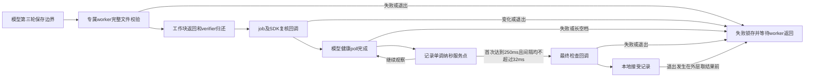

# 末轮观察的离线模型接线（2026-10-26）

已将[服务窗口策略](A23_SERVICE_OBSERVATION_OFFLINE.md)接到独立末轮控制器，完成专属worker、返回门、复核、模型健康poll、采样和最终检查回调的顺序验证。独立Python消费者重算所有服务间隔、窗口终点和事件顺序。最终r2的15个原生场景、35项消费者拒绝检查通过。

这次完成的是离线模型接线。真实接收器仍未采用该控制器；poll、job/SDK复核和finalCheck在fixture中是显式模型回调，没有真实SDK对象或原导出接线。不是当前132件的接收器build，不提供新硬件入口。旧417..464实测及其日志结论保持。

## 接线与保留约束

新增host/a23_terminal_observation.h/.m、tests/a23_terminal_observation_fixture.m、tools/a23_terminal_observation_consumer.py及tools/audit_a23_terminal_observation.py，共5来源，总659；旧654字节保持。

控制器每个实例只接受一次request，错误边界也耗掉该实例的机会。固定三轮已保存且无pending/stopped是模型入场条件；不会产生序号许可。worker在专用队列独占verifier，dispatch group通知只在工作块及其autorelease pool返回后归还所有权。busy结果不读verifier，不能接受或退出；退出请求可以锁存，但不会取消文件IO或绕过返回门。

复核成功后，先调用轻量poll，再取CLOCK_MONOTONIC_RAW纳秒服务点；后续也只在poll成功完成后取点。首次poll完成是窗口起点，之后每次poll耗时和队列空档都计入相邻间隔。没有逐tick完整文件校验或写盘。窗口只用一个初始化过的C状态，失败不清除，也不重开。

复核、poll、最终检查可能重入requestStop；即使回调随后返回YES，也不能清除停止。窗口通过后、外层读取结果前出现停止，accepted亦变false。finished是本地终态通知，调用者仍须在退出/导出时重新读取结果；它不是SDK排空或不可撤销成功凭证。

最终检查在窗口以后执行，其耗时不被服务窗口覆盖。模型不会释放/复用SDK存储或声称未来无事件。控制器也不能阻止外层销毁后创建新对象；真实集成仍必须由已有的一次性job/许可约束对象生命周期。

## 原生检查

使用旧126件冻结build的12个临时模型根和真实完整文件guard；没有把132件替换进旧scope。ASan/UBSan编译，-Wall/-Wextra/-Werror通过；动态依赖检查未发现IOKit或IOUSBHost链接。

| 最终r2场景 | 结果 |
| --- | --- |
| normal | 返回及复核后开始观察；252点，最大间隔1.124ms，本地接受 |
| bad-guard | 临时来源变化，文件guard失败，不启动窗口 |
| worker-stop / duplicate | worker忙时停止或重复request；不能提前退出，不调用poll，返回后保留失败 |
| deadline | guard期限经过，等待实际返回后结束，不启动窗口 |
| invalid-boundary | 数字pending=1不当作合法布尔；未派worker |
| guard-exception | worker异常转为失败，不启动窗口 |
| recheck-fail / recheck-stop | 复核返回失败或内部停止，不启动窗口 |
| poll-fail / poll-stop | poll失败或内部停止，已有2点不能形成通过记录 |
| blocked-tail | 约200ms处注入80ms阻塞；记录最大86.015ms空档，拒绝 |
| final-fail / final-stop | 服务窗口完成，最终检查失败或内部停止仍拒绝 |
| postpass-stop | 本地通过通知后、外层取结果前停止，accepted变false |

32ms是本地候选阈值，不保证其他负载下可通过，也不等于USB微帧或SDK期限。模型poll完成只证明这段模型回调完成，不证明任何真实SDK消息已经处理。

## 独立消费者

消费者要求调用者另外提供expected binding，包含本次模型run ID、659来源束摘要和旧build摘要；按JSON类型比较绑定，拒绝重复JSON键、整数冒充布尔及无效整数范围。它不自行读取卡或开启USB。

接受前必须独立重算：一次worker检查/实际返回/复核/最终检查，worker时间与截止时间，事件顺序和逐点poll对应，样本数量、严格递增时钟、每个相邻间隔、最大间隔和首次满足250ms的终点。不能只依赖accepted或max_gap_ns字段。

35项拒绝检查包括14种原生失败结果、18种单字段/绑定/顺序/时钟/计数篡改、2种同步修改摘要和事件的语义反例，以及重复JSON键。两种语义反例分别保持内部字段相互一致，却引入80ms末尾空档或把整个窗口缩短到240ms，仍由消费者按间隔/时长拒绝。

该消费者验证记录自洽及外部绑定，不认证生产者或历史真实性；知道绑定的作者仍可能伪造整段一致历史。因此producer_history_authenticated、actual_sdk_poll_verified、callback_drain_verified、buffer_reuse_verified保持false。

## 开发失败与封存

r1在blocked-tail的组合断言处退出（-6），此前11个原生场景完成。它只留下断言文本，没有完整终态记录，无法确认当时是注入未发生、先出现其他失败还是其他原因；不把原因归为调度或宣称修复根因。r1原样封存。

r2将fixture输出移到断言之前并flush，让后续失败保留完整终态；另加强“内部一致但时长不足”的消费者反例，使其独立因窗口不足拒绝。控制器、C策略和消费者本身均未因该失败改动。r2重新编译后完整15项矩阵通过，但不能反推r1发生了什么。

本轮共2个编译作业、27个原生fixture进程（r1含1失败、r2全部成功）、23次完整文件guard调用，均由创建者直接wait；两次依赖检查已退出。没有真实SDK对象、USB/SD访问、正式新namespace/范围或新授权。mutable ticket和actual417/九namespace在审计前后保持，收尾仅更新研究阶段和交接。

| 材料（相对private/analysis） | SHA256SUMS摘要 |
| --- | --- |
| A23-terminal-observation-wiring-20261026-r1 | 401a85eb871b61b47081d9469b0a47bed77525bb3553ea5fc074a14077783538 |
| A23-terminal-observation-wiring-20261026-r2 | a51e25f77b926ff2f156d47635e10504e927eede84913738aaa7c0fd5add34e9 |

最终来源束、未改actual417、九namespace清单、票据和交接见private/analysis/A23-terminal-observation-closeout-20261026。

下一项只做真实接收器的离线适配：从当前132件基线建立独立来源绑定，绕开旧driver的elapsed-only终态路径，接入真正轻量健康poll完成点，接回原最终导出/失败导出及worker退出门，再由消费者验收。旧126实测入口不得复用，尚不准备新的硬件测试。417..464已耗尽，remaining=0、acquisition_enabled=false，SD最后已弹出，设备日志不再待回收；当前现场状态未刷新。
